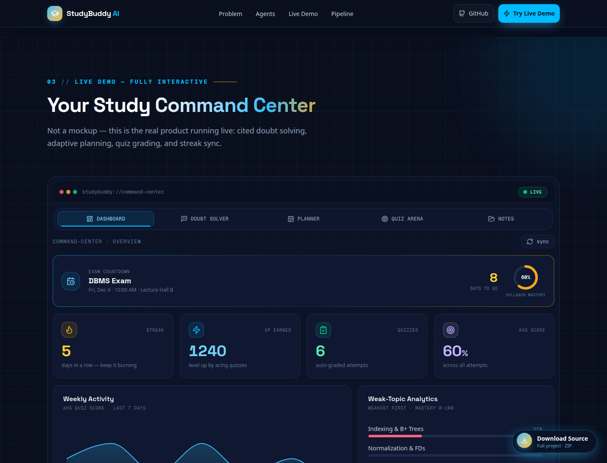

# StudyBuddy AI — Next.js App

A fully working, self-contained study copilot: a marketing landing page plus a live
five-tab product demo backed by its own Next.js API routes and a Prisma/SQLite database.

Everything runs with **zero credentials**. Add an OpenAI-compatible key (Groq, OpenAI,
Z-AI, …) and the agents upgrade from deterministic extraction to conversational answers
— no other code changes.



---

## What's inside

| Tab | What it does |
| --- | --- |
| **Dashboard** | Live streak, XP, quiz count, average score, weekly activity chart, weak-topic mastery, recent attempts, exam countdown. |
| **Doubt Solver** | Page-aware RAG over your notes. Streams an answer with `[Source: TITLE, Page N]` citations rendered as chips. Refuses to invent facts and tags answers that fall outside your notes. |
| **Planner** | Builds a day-by-day plan from the exam date, daily hours and weak topics. Restores the latest saved plan after a refresh. |
| **Quiz Arena** | Generates MCQs (3/5/8), grades instantly, explains every answer, updates XP/streak/mastery, and links back to the dashboard. |
| **Notes** | Add and delete notes. Content supports `--- Page N ---` markers so citations point at the right page. |

### Agents

All three agents share one LLM layer (`src/lib/llm.ts`):

1. **Z-AI SDK** — used automatically if `.z-ai-config` exists.
2. **Any OpenAI-compatible endpoint** — enabled by `LLM_API_KEY`, `LLM_BASE_URL`, `LLM_MODEL`.
3. **Offline mode** — deterministic extractive RAG for chat, rule-based planner and quiz
   authoring. This is what makes the demo work with no keys.

Rate limits (HTTP 429) are retried once; if the provider still fails, the route falls back
to the offline path instead of returning a 500.

### API routes

| Route | Methods | Purpose |
| --- | --- | --- |
| `/api/stats` | `GET` | Dashboard metrics, weak topics, recent attempts |
| `/api/notes` | `GET`, `POST`, `DELETE` | List / create / delete notes |
| `/api/plan` | `GET`, `POST` | Restore latest plan / generate a new one |
| `/api/quiz/generate` | `POST` | Author MCQs |
| `/api/quiz/submit` | `POST` | Grade an attempt, update streak + XP + mastery |
| `/api/chat` | `POST` | Streaming, cited doubt-solving answer |
| `/api/demo/reset` | `POST` | Wipe state and reseed the bundled DBMS notes |

---

## Quick start

```bash
npm install
cp .env.example .env          # optional: add an LLM key
npx prisma db push            # creates db/custom.db
npm run dev                   # http://localhost:3000
```

The database seeds itself on first request (4 DBMS notes, quiz history, mastery, profile).
Open the **Live Demo** section on the landing page to use the app.

### Environment

| Variable | Required | Notes |
| --- | --- | --- |
| `DATABASE_URL` | yes | `file:../db/custom.db` (relative to `prisma/`) |
| `LLM_API_KEY` | no | OpenAI-compatible key. Empty = offline mode. |
| `LLM_BASE_URL` | no | e.g. `https://api.groq.com/openai/v1` |
| `LLM_MODEL` | no | e.g. `openai/gpt-oss-120b` |
| `LLM_REASONING_EFFORT` | no | `low` for Groq `gpt-oss` models |

> `.env` is git-ignored. Never commit real keys.

---

## Scripts

```bash
npm run dev        # dev server on :3000
npm run build      # production build + standalone bundle
npm start          # run the standalone server
npm run lint       # eslint
npm run smoke      # API smoke test (14 checks) — run against a live server
npm run ui:smoke   # browser E2E test (needs playwright-core + a Chromium binary)
```

`npm run smoke` and `npm run ui:smoke` both reset the demo to a clean seeded state at the
end, so they are safe to re-run.

```bash
SMOKE_BASE_URL=https://your-deploy.example.com npm run smoke
CHROME_PATH=/usr/bin/chromium npm run ui:smoke
```

---

## Tech stack

- Next.js 16 (App Router, Turbopack) + React 19 + TypeScript
- Tailwind CSS v4 + shadcn/ui + Framer Motion + Recharts
- Prisma ORM + SQLite
- Streaming chat over `text/plain` with citation normalisation (`src/lib/citation.ts`)
